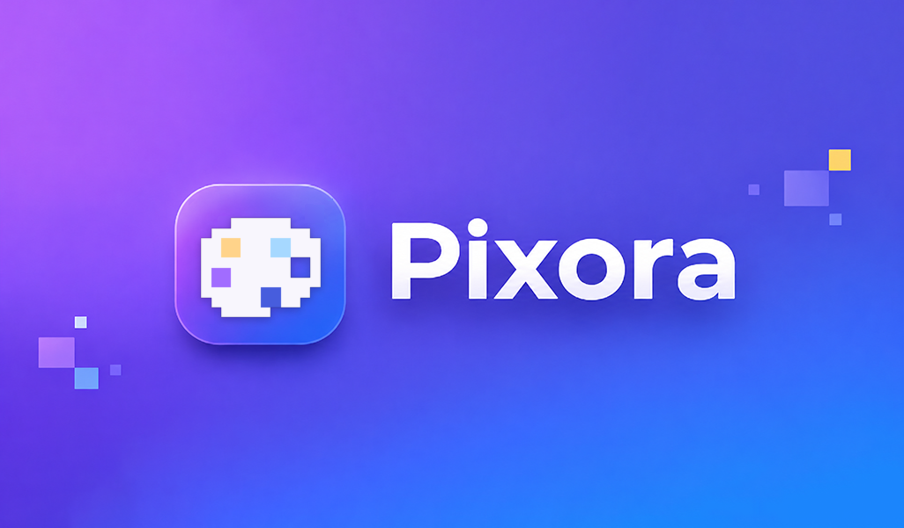
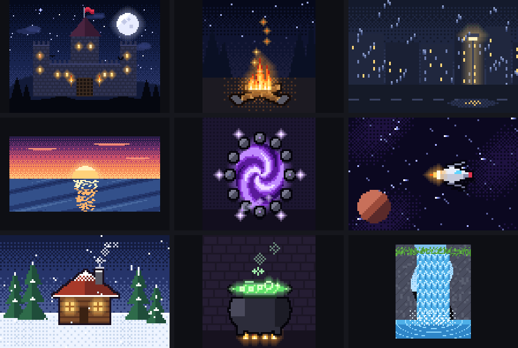
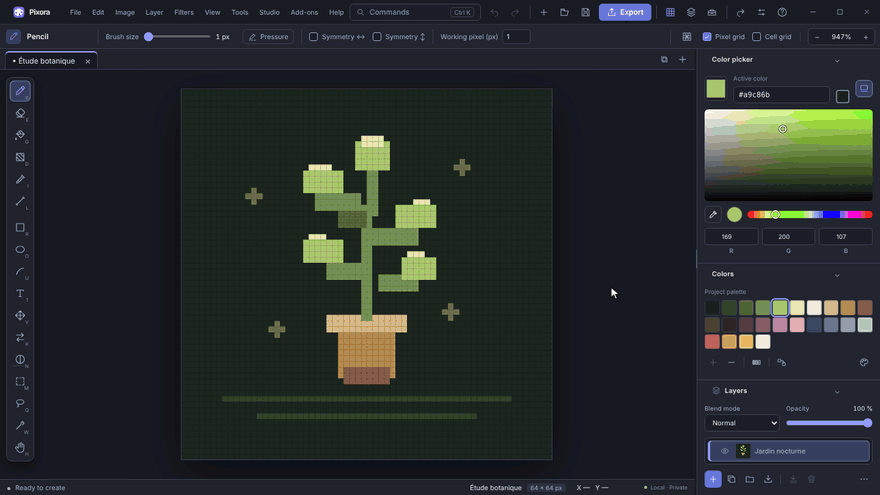
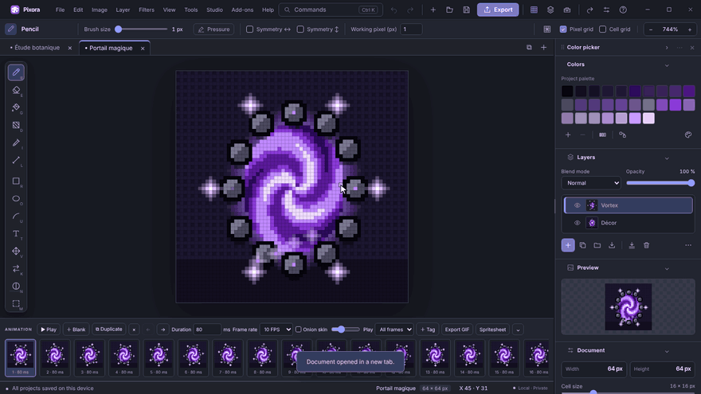
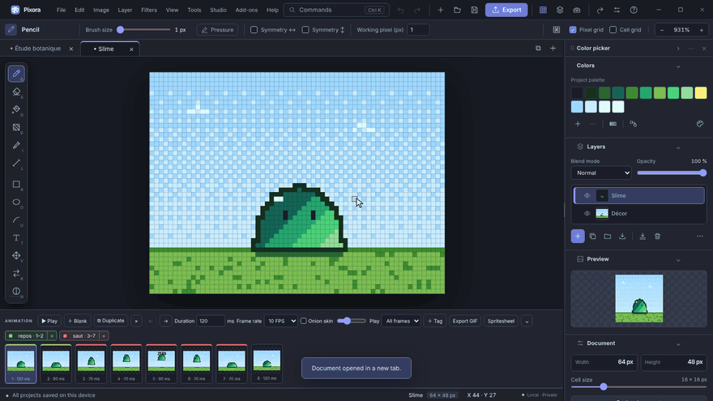
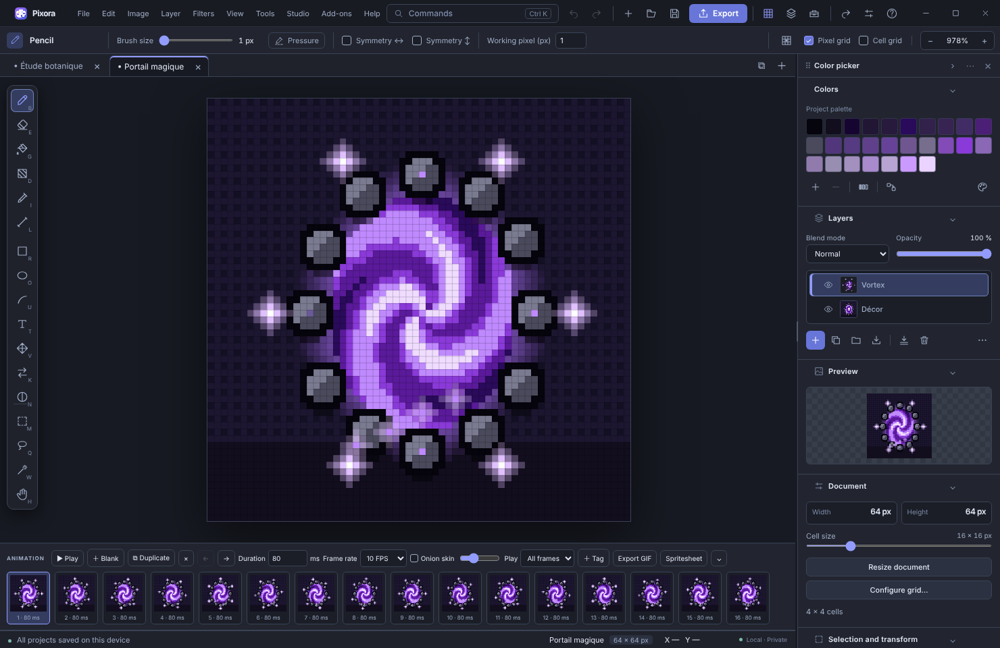

<p align="center">
  
</p>

<p align="center">
  
  
  
  
  
</p>

<p align="center">
  <strong>Draw, animate and export crisp pixel art.</strong><br>
  Sprites · textures · tilesets · animated GIFs · offline-first
</p>

<p align="center">
  <a href="https://github.com/itsnelys/Pixora-Releases/releases/latest"><b>⬇ Download the latest version</b></a> ·
  <a href="https://github.com/itsnelys/Pixora-Releases/releases">All releases</a> ·
  <a href="#-whats-inside">Features</a> ·
  <a href="#-the-pandora-suite">The suite</a>
</p>

---

Pixora is the pixel-art editor of the Pandora Interactive suite. Draw a 16 × 16 block texture, a character sprite, a tileset or a full animated scene, then export it as PNG, GIF, spritesheet or Aseprite file. Pixora makes the textures of Grimward and of every model built in [Jade](https://github.com/itsnelys/Jade-Releases). No account and no browser: your projects stay on your computer.

This repository hosts the **official Windows builds and release notes**. The application source code is private.

<p align="center">
  <br>
  <sub><b>Made with Pixora</b> · nine animated scenes, each a single <code>.pixel</code> project with 4 to 9 layers and 8 to 16 frames.</sub>
</p>

## ⬇ Download

| File | What it is |
| --- | --- |
| [**Pixora-Setup.exe**](https://github.com/itsnelys/Pixora-Releases/releases/latest/download/Pixora-Setup.exe) | Installer, with Start menu shortcuts and `.pixel` file association. Recommended. |
| [**Pixora-Portable.exe**](https://github.com/itsnelys/Pixora-Releases/releases/latest/download/Pixora-Portable.exe) | Runs without installation, from any folder or USB drive. |
| `Pixora.notpatch` · `Pixora.updater` | Release notes and update descriptor, read by Pixora's built-in update manager. |
| `SHA256SUMS.txt` | Checksums to verify every file you download. |

**Requirements:** Windows 10 or 11, 64-bit. Nothing else to install. The installer puts Pixora in `%LOCALAPPDATA%\Programs\Pixora`.

## 🎬 See it in action

<table>
<tr>
<td width="50%"><br><sub><b>Drawing</b> · a 24 × 24 mushroom from a new document: pencil for the outline, fill for the cap and stem, then spots, shadows and grass.</sub></td>
<td width="50%"><br><sub><b>Animation</b> · a 64 × 64 magic portal, 2 layers and 16 frames at 80 ms, played in the timeline.</sub></td>
</tr>
<tr>
<td colspan="2"><br><sub><b>Animation tags</b> · a slime with a <code>jump</code> and an <code>idle</code> sequence, each played on its own and exportable as its own GIF or sprite strip.</sub></td>
</tr>
</table>

<p align="center">
  
</p>

## ✨ What's inside

<table>
<tr>
<td width="50%" valign="top">

### ✏️ Drawing
- Pencil, eraser, fill, eyedropper, lines, rectangles, ellipses
- Symmetry and working-pixel size (1–64 px)
- Tile mode for seamless textures
- Graphics tablet support

</td>
<td width="50%" valign="top">

### 🗂 Layers and filters
- Groups, blend modes, opacity, locking, drag and drop
- Brightness / contrast, hue / saturation, levels, outline, drop shadow
- Colour quantization from 2 to 64 colours
- Previews before applying, everything undoable

</td>
</tr>
<tr>
<td valign="top">

### 🎞 Animation and Studio
- Timeline up to 64 frames with per-frame durations
- Onion skinning and playback (F8)
- Tilemaps painted from the project's tiles
- Visual history, recovery points and saved versions
- Up to four reference images in the project

</td>
<td valign="top">

### 🎨 Colours and export
- Detachable colour picker with on-screen eyedropper
- Palette extraction and hue sorting
- PNG, JPG and GIF; upscaled PNG without smoothing
- Spritesheets, every grid cell as a ZIP, animated GIFs
- Automatic pixel-size and grid detection

</td>
</tr>
</table>

**And everything you expect from the suite:** projects in tabs, an interactive first-launch guide, crash recovery, six themes, six languages (English, French, Spanish, German, Portuguese, Italian), customizable shortcuts, a command palette (Ctrl+K), Discord status, automatic updates and isolated add-ons.


## ⌨️ Essential shortcuts

| Action | Shortcut |
| --- | --- |
| Pencil / Eraser / Fill / Eyedropper | B / E / G / I |
| Line / Rectangle / Ellipse | L / R / O |
| Selection / Move | M / V |
| Undo / Redo | Ctrl+Z / Ctrl+Y |
| Play animation | F8 |
| Colour picker / Focus mode | F4 / F6 |
| Command palette / Preferences | Ctrl+K / Ctrl+, |
| Fit canvas / 100 % zoom | Ctrl+0 / Ctrl+1 |
| All shortcuts | F1 |

Mouse wheel to zoom, Space + drag to pan, Shift with the pencil for straight lines.


## 🛡 Verify your download

Open PowerShell in your download folder and compare the result with `SHA256SUMS.txt`:

```powershell
Get-FileHash .\Pixora-Setup.exe -Algorithm SHA256
```

Pixora is not signed with a commercial certificate yet, so Windows SmartScreen may show a warning the first time. Choose **More info → Run anyway** after checking the hash.

## 🧩 The Pandora suite

<table>
<tr>
<td align="center" width="33%"><a href="https://github.com/itsnelys/Pixora-Releases"><br><b>Pixora</b></a><br><sub>Pixel art, textures and animated sprites</sub></td>
<td align="center" width="33%"><a href="https://github.com/itsnelys/Jade-Releases"><br><b>Jade</b></a><br><sub>Cube models, rigs and animations</sub></td>
<td align="center" width="33%"><a href="https://github.com/itsnelys/Opal-Releases"><br><b>Opal</b></a><br><sub>Sound effects and adaptive music</sub></td>
</tr>
</table>

## 💬 Support

Questions or a problem? Send a problem report from inside Pixora, or write to **contact@pandora-interactive.fr**.

---

<p align="center"><sub><b>Pixora</b> by Pandora Interactive · © 2026 Pandora Interactive. All rights reserved.<br>Free downloads do not grant an open-source licence. The application source code is private.</sub></p>
